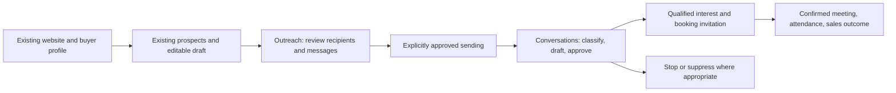

# Clientrove: from prospects to qualified conversations

Current implementation note: the historical research below predates the local monetary ledger and expanded manual day-two journey. [Current status](continuation/STATUS.md) supersedes its old implementation-gap statements. The ceiling is still not spending permission; historical account usage/current real prices are unaccepted and live operation remains blocked.

October 19, 2026. This research reflects the user's clarified goal: lead discovery is the first stage of a product that helps founders run outbound, handle conversations, qualify interest, and arrange meetings. It supersedes treating a list/draft/export workflow as the complete intended product. The agreed early-testing ceiling is **US$25 total per month, including existing DeepSeek search and model usage**. DeepSeek is already configured and should be reused by default. This is a planning constraint; there is no implemented global spend ledger or verified provider-account hard cap. No messages were sent, accounts connected, ads launched, purchases made, provider calls run, or app code changed for this research.

## Opinion and recommended position

**The fuller idea is stronger than another lead-list tool, but end-to-end AI outbound is already competitive.** The value to test is doing a founder's real acquisition work: choose suitable prospects, prepare relevant outreach, keep replies moving, identify genuine opportunities, and get suitable people into a conversation. A CSV is an input/output option, not the main value proposition.

Initial focus remains founders of launched **B2B SaaS** products with a defined company buyer and an offer they can explain. A useful hypothesis is **“Founder-approved outbound, from your product website to qualified conversations.”** It is an intended direction, not a description of the currently implemented app. The immediate advantage to earn is less setup and manual coordination for a small founder team, with trustworthy control and transparent cost. We have not established that we outperform competitors or that founders will pay us.

Do not equate prospects, replies, meetings, and customers. A relevant email reply is not necessarily buying interest. A booked meeting can be unqualified or unattended. An attended qualified meeting is a sales opportunity; a customer requires an actual purchase. Product reporting and pricing should preserve these distinctions.

## What the corrected Okara reference actually shows

The user supplied **[okara.ai](https://okara.ai/)**. Its official documentation describes an AI CMO that starts from a product URL, creates strategy, and produces ongoing work across SEO, social, content, coding, and influencer agents for founders and small teams. This is a broader marketing-execution product. [Okara introduction](https://okara.ai/docs/introduction).

Its homepage describes integrations that publish approved work and report back. The useful analogy is one business context, coordinated execution, approvals, and a continuing work feed. The public materials reviewed do not establish a general cold-email sales/reply-qualification/meeting engine as its core product. [Okara homepage](https://okara.ai/).

The **Influencer Agent** gives a concrete end-to-end example: campaign brief, creator matching, outreach/rates, deliverable management, and payouts for X/LinkedIn creator campaigns. This is creator campaign execution, not proof that Okara sells general sales meetings. [Okara Influencer Agent](https://okara.ai/agent/influencer).

Okara explicitly lists Free analysis/strategy, Lite at **US$129/month**, and Pro at **US$249/month** with monthly billing. Those are current vendor prices, not a Clientrove pricing recommendation, verified business margins, or evidence of our demand. [Okara pricing](https://okara.ai/pricing).

## Direct outbound comparisons

| Verified public product description | What it means for our decision |
| --- | --- |
| Reply/Jason describes website-derived offers, sequences, prospect sourcing, message generation, reply handling, and booking meetings. Approval mode holds messages for human approval. | The complete journey is established competitive territory. Approvals and grounded replies are credible product features, not a reason to stop at lists. |
| Artisan describes qualifying prospects before sending a booking link, answering from the business knowledge base, and escalating where needed. | Qualification and conversation continuity are part of the job; calendar integration alone is not the outcome. |
| AiSDR advertises pay-as-you-go at **US$1.50 per person prospected**, with research/list/writing included, alongside reply handling and a unified inbox. | Existing products already combine data and execution at transparent entry pricing. Price and simpler founder onboarding need testing against real alternatives. |
| Explee separates an outreach-agent product from database research/email services. | The user's point is valid: data access and acquisition execution are different value propositions. |

Sources: [Reply AI SDR capabilities](https://how.reply.io/capabilities/ai-sdr/), [Artisan scheduling and qualification](https://www.artisan.co/meeting-scheduling-software), [AiSDR pricing](https://aisdr.com/pricing/), [Explee pricing](https://explee.com/pricing). These are first-party feature/price claims, not independent accuracy, conversion, customer-count, or profitability evidence. Do not import their advertised response or meeting rates into our forecast.

## The smallest credible next slice

Build and test **one supervised email-outbound loop**, including replies and an existing booking link. This tests the intended outcome more directly than more list UI, while avoiding a full CRM or many channels. It is a recommendation for future implementation, not authorization to send anything now.

1. **Confirm the offer once.** Start from the existing website/profile. Approve the buyer criteria, factual product answers, current pricing/offer, exclusions, sender identity, booking link, and allowed spending/contact limits. A website alone is insufficient for promises about integrations, discounts, security, or commercial commitments.
2. **Choose a small eligible prospect cohort.** Reuse the current discovery/contact workflow. Require relevant evidence and contact eligibility; verify an address when verification is promised. Apply existing-customer, previous-contact, and opt-out exclusions. Keep the current five-result testing cap until separately changing the job/budget design; do not promise hundreds.
3. **Connect one authorized sending account.** Use a provider/integration whose terms permit the intended use, secure delegated access, tested mailbox/thread synchronization, and a plainly visible disconnect/pause control. Connection and recipient eligibility are prerequisites, not permissions inferred from an API key or a published address.
4. **Approve the actual outreach.** The first slice presents the recipient, source-backed initial message, and any follow-up for review before sending. Persist approval against the exact content/recipient/version. Edits invalidate the old approval. Send once with durable status and duplicate protection. Do not purchase lookalike domains, manufacture engagement, or rotate identities to evade restrictions.
5. **Bring replies into one conversation view.** Any reply pauses planned follow-ups while the thread is assessed. Classify interest, question, not-now, wrong-person, rejection, unsubscribe, out-of-office, and uncertainty. Let the founder correct classification. Generate a reply from the actual thread plus approved product facts; initially require approval before it sends. Escalate unknown answers and commercial commitments instead of inventing them.
6. **Qualify and invite at the right moment.** Agree the qualifying criteria in advance: relevant company/use case, suitable contact or referral, and expressed interest in discussing the product. Avoid turning a friendly response into “qualified.” A reviewed response can offer the founder's existing booking link after interest. Record a meeting as booked only on genuine calendar/booking confirmation; keep cancellation, attendance, and qualification separate.
7. **Close the feedback loop.** Show what needs the founder now: pending approvals, unanswered questions, interested conversations, and upcoming meetings. Capture accepted/rejected prospects and eventual outcomes to inform the next approved batch. Learning from outcomes is a future capability to validate, not an existing proprietary advantage.

The new product surface should be a compact **Outreach workspace**: prospects/approvals and conversations, with meetings visible in context. The existing draft modal remains useful for preparation. A full deal pipeline, billing CRM, multichannel automation, influencer payments, and every marketing agent from Okara are not prerequisites for the first genuine prospect-to-meeting test. They are possible later expansion, not unwanted goals or features already built.

## Keep the first test inexpensive

The user explicitly wants a very low testing budget and will scale after first customers. **Reuse existing capabilities first; buy a narrow missing capability only when it resolves a demonstrated problem.** The agreed limit is **US$25 total monthly across early testing**, including DeepSeek search/model, any new data/verifier/tool usage, mailbox/sequencer expenses, and other test spending. It is not $25 per tool or per tenant, and previously incurred usage must be included. No new subscription, top-up, or paid execution is authorized by this research report. Actual remaining budget has not been reconciled from provider receipts.

| Job | Lean first approach | Buy/build later only if needed |
| --- | --- | --- |
| Company discovery | Existing DeepSeek Search key and bounded public-site fetches; preserve the five-business test cap. | A targeted enrichment source when accepted-company/contact coverage is demonstrably inadequate. Do not add automatic paid fallback chains. |
| Missing public data | Inspect one suitable Apify Actor or Monid endpoint and its schema, pricing, limits, and data rights before choosing it. | One explicitly capped test, then compare incremental accepted reachable businesses per dollar. Stop if it merely adds duplicates or weak candidates. |
| Messages and reply assistance | Existing DeepSeek drafting plus a small approved product knowledge base and authorized test conversations. Cache reusable outputs and cap tokens/attempts. | More model orchestration only when measured reply quality needs it; a cheaper token price does not establish a cheaper outcome. |
| First real outreach pilot | A founder's existing, permitted mailbox and booking link with human-reviewed sending and replies. Manual operations are acceptable if clearly disclosed and counted. | One sending/reply integration after the workflow proves useful. Prefer a provider's tested transport over building SMTP infrastructure. |
| Scheduling | Existing booking link; distinguish a sent link from a confirmed booking. | Calendar availability/webhooks once real usage needs synchronized booking/cancellation states. |

An initial **reply-copilot prototype** can accept an authorized example thread, classify the reply, and draft a grounded response/appropriate booking invitation for human review without connecting an inbox. This tests answer quality, control, and time saved at low infrastructure cost. It is not a seamless production integration and must not be presented as automated sending or proof of cold-outbound response rates. A genuine approved outbound pilot is still required to test the whole outcome.

[Apify's current pricing](https://apify.com/pricing) lists a free plan with **$5/month platform credit**, no card required, and Actor-specific pricing models. Runtime, data transfer, storage, proxy use, and retry costs can affect a run, including cases where an Actor combines event and platform charges. Free credits are limited and do not establish usable-data yield or redistribution rights. Inspect the exact Actor, avoid subscriptions/overages for the initial test, and skip blocked sites rather than use tooling to bypass restrictions.

[Monid](https://monid.ai/) advertises pay-as-you-go access and **$1 starting credit**; eligibility/balance has not been verified for this user. Its [pricing docs](https://docs.monid.ai/guide/pricing.html) distinguish per-call from per-result charges, with prices shown during discovery/inspection and actual costs in run responses. Its [inspection guidance](https://docs.monid.ai/cli/inspect.html) requires checking schema and price first. Availability through a shared balance does not by itself settle the underlying supplier's commercial/data-use terms. No Monid or Apify account, authenticated endpoint discovery, or paid execution occurred in this research.

Before new paid tests, implement the **US$25 global monthly ceiling and subordinate per-tenant daily/monthly ceilings**, then reserve a worst-case bounded job cost before execution and reconcile actual receipts afterward. Also cap provider calls/results, page fetches/bytes/time, model input/output tokens and regenerations, concurrent jobs, and any authorized messages/follow-ups. Set conservative handling for uncertain prices; stop rather than silently exceed the remaining budget. Disable automatic top-ups, paid fallback and unbounded retries. Keep local-key status and free credits separate from actual remaining spend authorization. These monetary controls are proposed requirements: no global ledger is implemented, and the provider-account billing settings have not been verified as capped.

## Trust and operational requirements belong in the slice

Approval-first is useful here because reply quality and sender reputation are unproven; it does not prevent later carefully scoped automation after quality evidence and explicit user configuration. Suppression, opt-outs, hard bounces, disconnected mailboxes, and user pause must stop sending automatically. Recheck current thread/permission state before sending a queued reply; never answer an unsubscribe or treat inbound text as authority to change settings or reveal data.

Reply's own documentation distinguishes reply categories, pauses, approval/draft modes, and no AI replies to do-not-contact threads. This is evidence of concrete failure cases a credible product must handle. [Reply management documentation](https://how.reply.io/capabilities/reply-management/).

Published contact data and deliverability verification do not establish permission to send. Sender/recipient jurisdictions, supplier data rights, and sending-provider terms must fit the proposed use. The FTC states that US CAN-SPAM covers B2B commercial email and requires honest identity/content, address, and opt-out handling. Canada's CASL has a different regime; choose the initial market and confirm the applicable permission basis before real outreach. [FTC business guidance](https://www.ftc.gov/business-guidance/resources/can-spam-act-compliance-guide-business), [CRTC anti-spam guidance](https://crtc.gc.ca/eng/internet/anti.htm).

Google's sender guidance covers authentication, reputation, abuse monitoring, and opt-out requirements and cautions against unwanted email; an authenticated mailbox is not assurance of inbox delivery or permission for every campaign. Choose a suitable provider and meet its rules, rather than design around bypassing them. [Google sender guidance](https://support.google.com/mail/answer/81126?hl=en).

## What would justify payment

Sell a bounded, managed workflow with understandable limits: prospects processed, allowed outreach, grounded reply assistance, and visibility into actual outcomes. A workspace fee with included active prospects/conversation work and opt-in usage top-ups is easier to control initially than unlimited autonomous sending. Include infrastructure and support costs in the offer. Pricing is not set by cheap Search API cost.

Avoid pay-per-meeting until qualification, duplicates, attribution, cancellations, no-shows, disputes, and credits are auditable. A fee for an objectively defined qualified **attended** meeting may be an option later, but it is harder operationally than charging for a bounded service. Revenue sharing is even harder without reliable closed-won attribution. No model can guarantee product-market fit, recipient replies, attendance, or a sale.

```text
Delivery cost = research + enrichment + verification + model attempts
              + mailbox/sending + reply/calendar integrations
              + hosting + support/human review + failed work + refunds

Cost per qualified positive reply = all delivery cost / such replies
Cost per qualified attended meeting = all delivery cost / such meetings
Clientrove contribution = collected fees - variable delivery/payment/refund costs

Founder outbound CAC = Clientrove fees + mailbox/tools + founder sales effort
                       divided by attributable new paying SaaS customers
```

With zero qualified meetings or sales, report cost and zero yield rather than a fabricated finite unit cost. Separate Clientrove's own customer-acquisition cost from its customer's outbound acquisition cost. Use measured retention and realized gross profit when judging economic value; a hypothetical lifetime value or competitor meeting rate is not evidence. No end-to-end outbound cost has been measured in the current app.

## Validation and decision gates

First test the reply/suppression/approval/calendar state machine using injected or authorized test conversations—no real prospects required. Before a real pilot, obtain explicit approval for the sending setup, recipients/campaign, limits, and commercial terms. Research authorization alone does not authorize outreach.

Then recruit a few qualified B2B SaaS founders for a clearly disclosed assisted pilot with one buyer segment and one channel. Manually supported delivery is acceptable if disclosed and its labor is counted. Use approved batches within the validated cap. A small initial batch is useful for fact/permission/failure checks; it cannot establish statistically reliable reply or meeting rates. Agree duration, maximum exposure/spend, failure/refund handling, and a paid continuation offer before launch. No campaign or pilot has been launched by this research.

| Stage | Measure |
| --- | --- |
| Candidate quality | Founder-accepted relevance, usable contacts, duplicate/exclusion errors, cost across all attempted research. |
| Outreach quality | Factual accuracy, approval/edit/reject rate, time required, duplicate sends, provider rejections, bounces, complaints, opt-outs. |
| Conversation value | Genuine positive replies versus questions/negative/automated replies; correct classification; unanswered questions; response time; unsafe/invented answers. |
| Sales progress | Qualified conversations, booked meetings, cancellations, qualified attended meetings, opportunities, and actual paid customers as distinct events. |
| Commercial value | Founder time saved, repeated use, real payment/renewal/refunds, full delivery cost, and acquisition/payback economics. |

Continue only if founders trust the messages, can use the resulting conversations, return, and pay at a delivery cost that leaves room for a sustainable business. If replies are poor, inspect targeting, offer, facts, and delivery before increasing volume. If meetings are unqualified, fix qualification rather than count more bookings. If useful conversations still do not produce paid continuation, reconsider the segment/offer.

**Recommended next step:** specify and prototype the supervised send → reply → qualify → booking-link loop around the existing prospect/draft foundation, then validate it with explicit pilot authorization. Keep the public landing honest about today's list-and-draft capability until the fuller workflow actually works.

Start with authorized test conversations and the existing DeepSeek setup; reconcile remaining funds and implement the agreed US$25 ceiling before new paid test work. Sending still requires its own explicit approval. Defer new inbox/domain fleets, broad data subscriptions, advanced autonomous sequences, CRM construction, and multi-channel expansion until real customers demonstrate useful conversations and willingness to pay.

## Lean next visual workflow



The first two stages exist. Subsequent stages are **proposed**, not available in today's app. Keep them within one Outreach workspace with three simple views rather than a separate page for each backend tool:

1. **Review:** the chosen businesses, actual recipients, editable messages, allowance/cost summary, and clear approval state. In the first prototype, sending can remain a disclosed manual step; do not display a working send button without transport, approval, suppression, and budget checks.
2. **Conversations:** one thread, a brief interest/category status, the proposed answer, and approve/edit/pause actions. Start with authorized sample threads before inbox connection. On phone, the thread and composer should fill the screen with a clear return action; do not squeeze a desktop inbox into horizontal scrolling.
3. **Meetings:** a small contextual agenda with booking confirmation, qualification, cancellation/attendance, and manually reported sales outcome. It is not yet a full CRM. A sent booking link must not appear as a booked meeting.

This keeps Okara's useful lesson—approved execution and progress in one place—while testing Clientrove's narrower sales-conversation outcome at the agreed budget.
